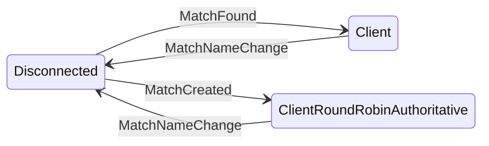
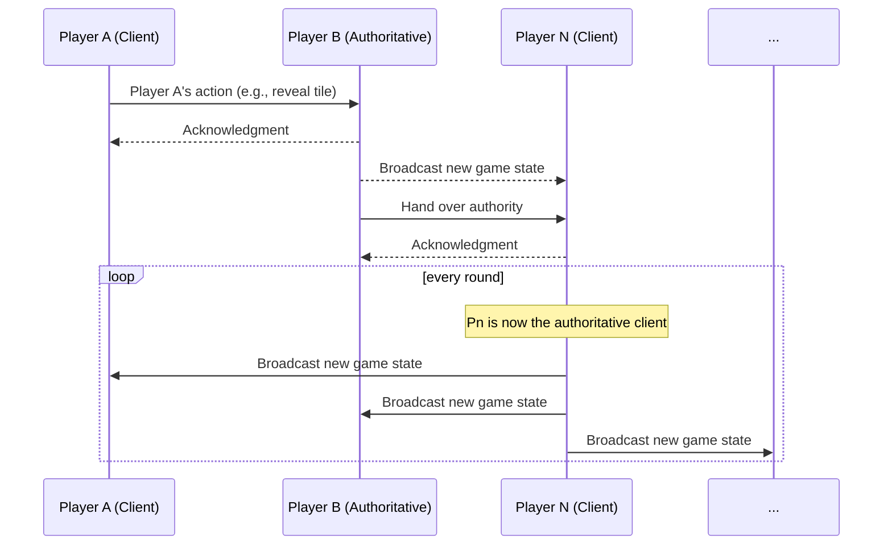
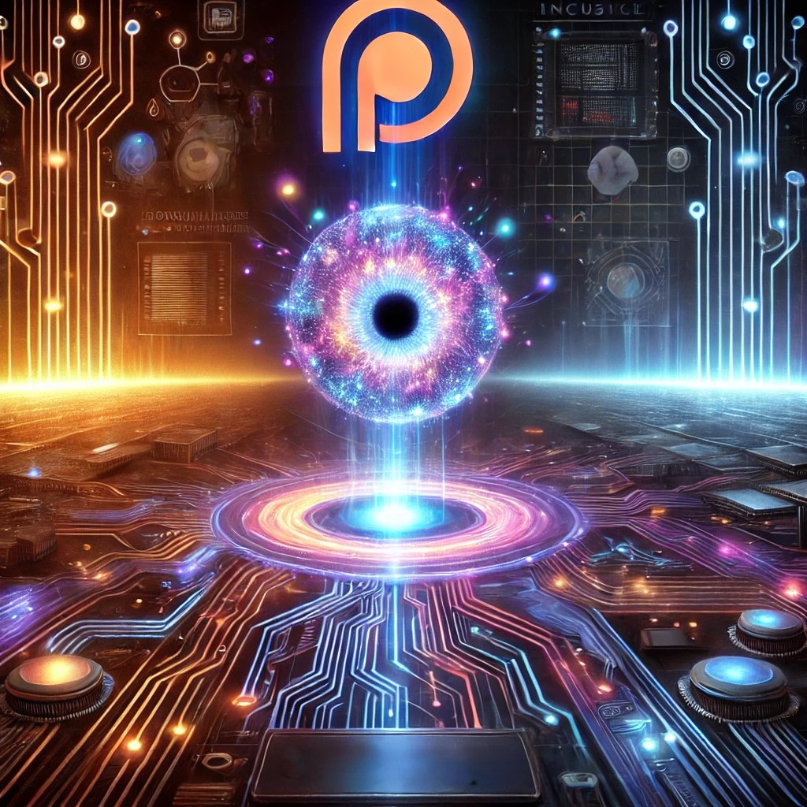

# GitHackforFun###
**3D Minesweeper: Because P2P State Shouldn't Be a Mess** 💥

Welcome, fellow explorer\! This isn't just a 3D Minesweeper game; it's a testament to the **architectural imperative** of a **peer-to-peer** game loop. We've taken the core of our **FSM\_API**, the concept that state shouldn't be a mess, and applied it to a multiplayer, 3D environment using a new `FSM_Helix` package.

This project is a foundational stepping stone for building future complex, 3D applications and game prototypes. It showcases a sophisticated architecture that can scale to high player numbers by dynamically expanding the game board and delegating authority to a round-robin system.

-----

### **The Core Architecture: FSM-Driven P2P**

Our solution re-imagines the game's control flow using our FSM\_API to manage a decentralized peer-to-peer system. Each client can exist in one of four distinct application states:

  * `Disconnected`: The initial state when a player enters a new match name or first launches the app.
  * `Client`: The player is connected to a match and receives updates, but they do not have network authority for the current frame.
  * `Client-RoundRobinAuthoritative`: The player's client is the arbiter of all updates for the current frame. They process local actions and broadcast the authoritative state to the group.
  * `Authoritative`: This state is an abstraction of the `Client-RoundRobinAuthoritative` state, representing the current authority.

This round-robin system ensures a distributed, fault-tolerant game loop, while the FSM\_API guarantees that each client remains in a predictable, consistent state.

-----

### **Game Flow and FSM State Management**

When a player launches the app, a simple, collapsible UI appears, allowing them to enter a name, a match name, and a player color (which is randomly assigned if not set).

#### **Player-Driven State Transitions**

The game's primary flow is managed by an FSM that follows player actions:

  * A user starts the app and is immediately put into the `Disconnected` state.
  * The system tries to find or create a game with the name "Default." If found, the client joins and transitions to the `Client` state. If no match is found, the client creates one and transitions to the `Client-RoundRobinAuthoritative` state.
  * If a user changes the match name in the UI, their client broadcasts a disconnect message to the current group and re-enters the `Disconnected` state, seeking a new match.

#### **State Diagram: Player Client States**

#### **State Transition Table: Player Client States**

| Current State                   | Event/Trigger              | Next State                      | Action                                                                                                 |
|---------------------------------|----------------------------|---------------------------------|--------------------------------------------------------------------------------------------------------|
| Disconnected                    | `MatchFound(MatchName)`    | Client                          | Joins the match, syncs board state, and awaits the next authoritative frame.                           |
| Disconnected                    | `NoMatchFound(MatchName)`  | Client-RoundRobinAuthoritative  | Creates a new match, sets the initial board size, and becomes the first authoritative client.            |
| Client                          | `MatchNameChanged(NewName)`| Disconnected                    | Sends a disconnect broadcast, asyncs search for a new match, and enters a disconnected state.            |
| Client-RoundRobinAuthoritative  | `MatchNameChanged(NewName)`| Disconnected                    | Sends a disconnect broadcast, asyncs search for a new match, and enters a disconnected state.            |

-----

### **The Game Loop: A P2P Round Robin**

Game actions, such as revealing a tile or placing a flag, are an integral part of this FSM-driven peer-to-peer loop.

1.  A player initiates an action on a cell they are "standing" on.
2.  Their client sends this action to the current `Authoritative` client.
3.  The `Authoritative` client processes the request and then broadcasts the new game state to all other `Client`s in the match.
4.  The `Authoritative` client then passes authority to the next client in the round-robin queue, transitioning that client to the `Client-RoundRobinAuthoritative` state.

#### **Sequence Diagram: Authoritative Update**

-----

### **Brought to you by:**

**The Singularity Workshop** - Tools for the curious, the bold, and the systemically inclined.

Because state shouldn't be a mess.

  * **API NuGet Package**: [https://www.nuget.org/packages/TheSingularityWorkshop.FSM\_API](https://www.nuget.org/packages/TheSingularityWorkshop.FSM_API)
  
  * **FSM\_API Repository**: [https://github.com/TrentBest/FSM\_API](https://github.com/TrentBest/FSM_API)
  
  * **💖 Support the Project**: [**Donate via PayPal**](https://www.paypal.com/donate/?hosted_button_id=3Z7263LCQMV9J)